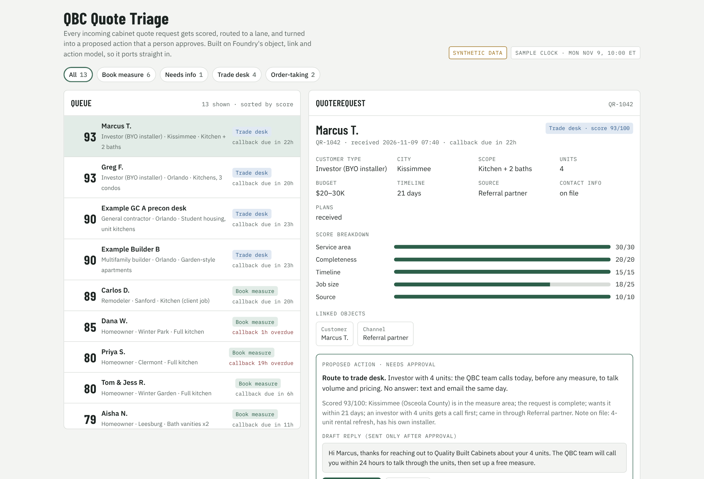
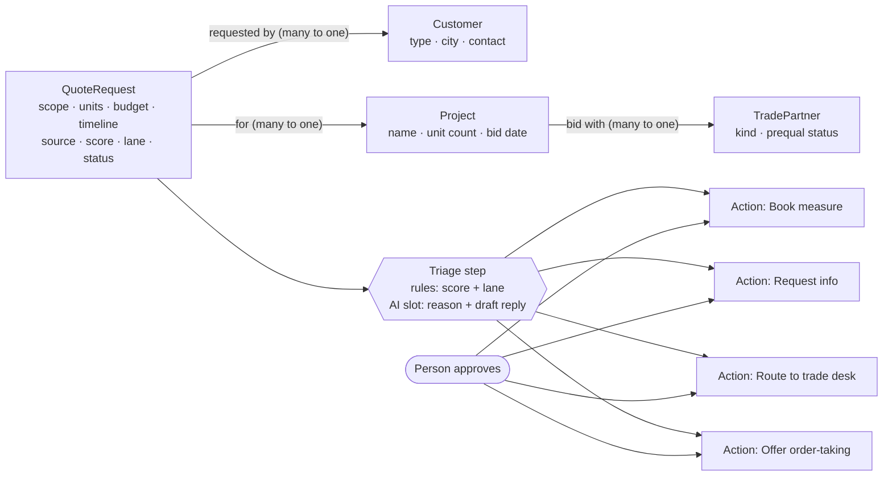
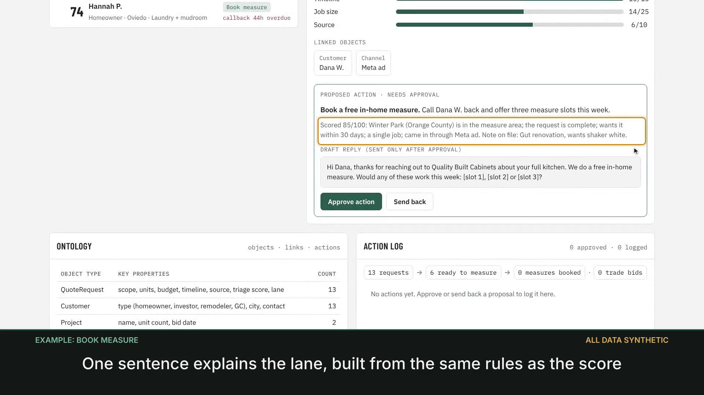
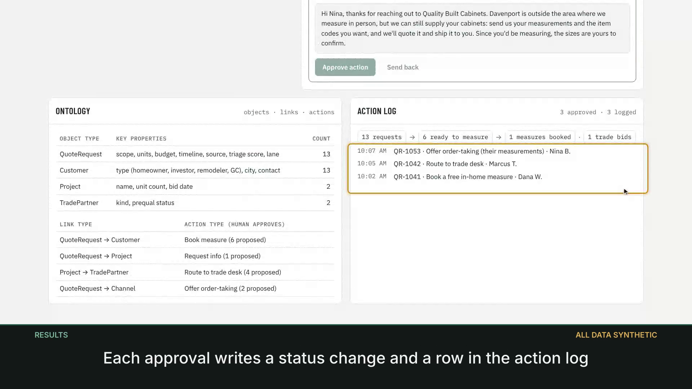

# Lead Sorter

Lead Sorter reads each new quote request for a small cabinet business and picks the next step: book a measure, ask for missing info, have the team call a builder first, or take the order on the customer's own measurements. It gives a one-sentence reason and a draft reply, and nothing happens until a person approves it.

It is a standalone prototype: one HTML file, no build step, no server. It is modeled on Palantir Foundry's ontology (object types, link types and action types) so it can be ported into Foundry later.

> **All data is SYNTHETIC: made up on purpose, because we don't publish our customers' information.** Every name, request and trade partner in this repo is invented; the cities are real places, used only to test the service-area rule. QBC uses it every day to sort its incoming quote requests. No real customer data and no data from any employer is used.

## Why it exists

Quality Built Cabinets (QBC) is a Central Florida cabinet business I co-founded with two partners. It supplies cabinets and does not install them. It measures in person in four counties around Orlando and takes orders on the customer's own measurements everywhere else. It promises a callback within 24 hours.

Each request needs a different first move: book a measure, ask for a missing detail, have the QBC team call a volume buyer first, or offer order-taking to someone outside the measure area. The wrong move wastes an afternoon or leaves a homeowner measuring their own kitchen. The question this prototype asks: can every request arrive already sorted, with a reason, so a person only has to check it and approve it?

## The ontology

I modeled the business before writing any logic.

- **Object types:** QuoteRequest, Customer, Project and TradePartner.
- **Link types:** QuoteRequest → Customer, QuoteRequest → Project, Project → TradePartner. The app also shows QuoteRequest → Channel; for now Channel is stored as a property, and it becomes an object once it carries its own attributes (such as ad spend).
- **Action types:** one per lane. Each waits for a person. Each approval writes a status change and a row in the action log.

## The rules

The **score** (out of 100) sorts the queue:

| Part | Points | Rule |
| --- | --- | --- |
| Service area | 30 | Inside the measure area 30, outside 10 |
| Job size | 25 | 10+ units 25; 2–9 units 18; a kitchen 14; anything else 8 |
| Completeness | 20 | Minus 7 for each missing phone, timeline or budget |
| Timeline | 15 | Up to 30 days 15; up to 90 days 10; longer 5; missing 0 |
| Source | 10 | Referral, outbound or prequal 10; anything else 6 |

The **lane** comes from fixed rules, checked in this order:

1. **Trade desk:** 10 or more units, or an investor with 2–9 units. The QBC team calls first.
2. **Order-taking:** outside the measure area (Orange, Seminole, Osceola and Lake counties). The customer sends measurements and item codes.
3. **Needs info:** inside the area but missing details. The draft asks only for what is missing.
4. **Book measure:** everything else. The draft offers a free in-home measure.

Score and lane are separate on purpose. Checking trade first means a 200-unit job reaches the trade desk even when it is outside the measure area.

**Rules decide; the model only writes.** A lane has money attached, so it comes from rules that can be tested line by line. The AI slot only writes the one-sentence reason and the draft reply. Today that slot is filled by templates built from the same rule parts; no model runs yet.

## How to run it

- **Open the file:** download `index.html` and open it in any modern browser. It needs an internet connection only for the Google Fonts; without one it falls back to system fonts.
- **Or serve the folder:** `python3 -m http.server 8000` in this folder, then visit `http://localhost:8000`.

Then pick a request in the queue, read its score breakdown, reason and draft, and click **Approve action** or **Send back**. Filter by lane with the buttons at the top. Approvals update the funnel and the action log.

Where things live in `index.html`:

| Piece | Name in the code |
| --- | --- |
| The 13 synthetic requests and 2 trade partners | `REQ`, `GCS` |
| The measure area | `COUNTY` |
| Score and lane | `triage()` |
| Lane labels, actions and draft replies | `LANE` |
| The one-sentence reason | `why()` |
| The 24-hour callback clock | `slaText()` (the app runs on a fixed sample clock, Mon Nov 9, 10:00 ET) |

## How it maps to Foundry and AIP

| Prototype | Foundry / AIP |
| --- | --- |
| 4 entity types and their fields | Object types in Ontology Manager, backed by datasets |
| Relationships | Link types |
| `triage()` | A Function on QuoteRequest returning score, lane and missing fields, with unit tests |
| Reason and draft reply | AIP Logic, tested with AIP Evals (the 13 synthetic requests as cases) |
| Approve buttons | Four action types, with submission criteria that block approval when required fields are missing |
| Triage on arrival | Automate, on new QuoteRequests |
| Queue, detail, funnel, log | A Workshop module |

## Limits

- **Synthetic only.** No real request has been routed, so there is no accuracy, speed or conversion number.
- **No model runs yet.** The reason and the replies come from templates.
- **Not yet in Foundry.** New AIP Developer Tier sign-ups were paused when this was built (November 2026).
- **Free text is not parsed.** Turning an emailed request into fields is the obvious next step.
- **The weights are judgment calls,** not fitted to data.

## How it was built

I designed the ontology and made the routing calls. Most of the code was written with an AI coding assistant (Claude, by Anthropic).

Not affiliated with or endorsed by Palantir Technologies. "Foundry", "AIP" and related names are theirs.

## License

MIT. See [LICENSE](LICENSE).
